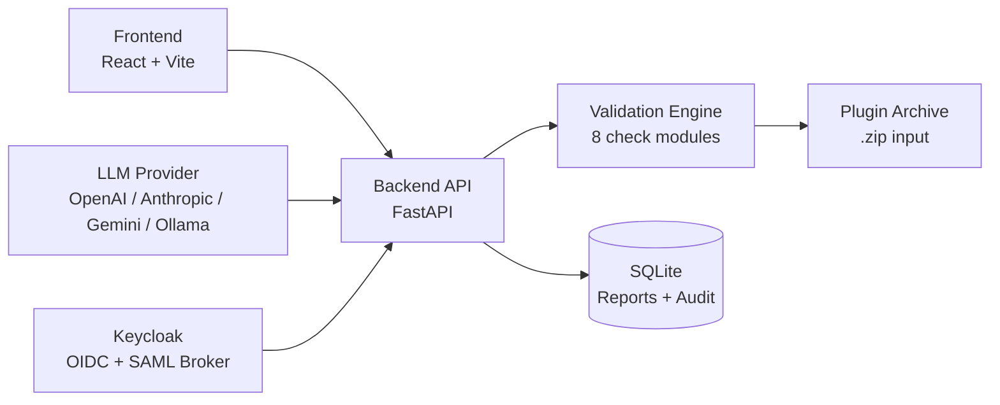

# Prism Lens

> Work in progress. This checkpoint may be incomplete or fail tests. See PLAN.md and STATUS.md before use.


**Alan Vo | AI & Machine Learning**

Cursor plugins fail to load silently — a skill `name` with capitals breaks
portability (issue #237), a symlinked install directory stops discovery (issue
#35), an undeclared `${VAR}` in `mcp.json` breaks the MCP connector (issue
#531), and missing OAuth scopes return opaque 403s (issue #385). Prism Lens
is a diagnostic tool that validates a plugin archive against the Agent Skills
specification and explains the structural root causes of these failures through
deterministic static-analysis checks, with an opt-in LLM advisory that is
grounded in the actual findings.

**Intended user:** plugin developers, Cursor bot operators, and CI engineers
who need to understand why a plugin is not loading or a connector is failing.

The deterministic core runs fully offline — no LLM key required. The LLM
advisory (when configured) produces a natural-language summary of *why* the
top findings block plugin loading, citing the specific check IDs. LLM output
is labeled advisory and never overrides the deterministic engine.

## Installation

### Local development

```bash
# Backend
python3 -m venv .venv
.venv/bin/pip install -r backend/requirements.txt
.venv/bin/python -m pytest backend/tests

# Frontend
cd frontend
npm install
npm run build
npm test
```

### Docker

```bash
cp .env.example .env
docker compose up --build
# Backend:  http://localhost:8000
# Frontend: http://localhost:5173
# Keycloak: http://localhost:8080
```

### Running the API

```bash
.venv/bin/uvicorn backend.app.main:app --reload --host 127.0.0.1 --port 8000
```

### Running the frontend

```bash
cd frontend
npm run dev
# Opens http://localhost:5173
```

## Architecture



## Workflows

1. **Validate a plugin** — Upload a `.zip` archive; the backend extracts it and
   runs 8 categories of deterministic checks against the extracted tree.
2. **View detailed report** — Browse findings grouped by category, filter by
   severity (error / warning / info), and view file paths and line numbers.
3. **Export & request advisory** — Export the report as JSON or plain text.
   Request an opt-in LLM advisory that explains why the findings block plugin
   loading.

## Validation Checks

| Category | Check | Originating issue |
|----------|-------|-------------------|
| manifest | Manifest exists, valid JSON, required fields, name pattern | #531 |
| skills | Skill `name` matches folder name and conforms to identifier rules | #237, #381 |
| agents | Agent frontmatter is valid YAML with required fields | #531 |
| hooks | `hooks.json` is valid and referenced scripts exist | #531 |
| mcp | `mcp.json` structure, `${VAR}` declared in `variables` | #531 |
| paths | All component paths in manifest exist | #531 |
| symlinks | Detects symlinked plugin components | #35 |
| oauth | Gmail filter tools require `gmail.settings.basic` scope | #385, #278 |

## AI/ML Evaluation

The validation engine is a rule-based system encoded from analysis of issue
reports #237, #35, #251, #278, #385, #472, #531, and the Agent Skills
specification. Each rule maps to a concrete, reproducible failure mode.

**Reproducible command:**
```bash
.venv/bin/python -m pytest backend/tests/test_checks.py -v
```

**Data provenance:** Rules derived from the Cursor plugin issue tracker
(https://github.com/cursor/plugins) and the public Agent Skills specification
(https://agentskills.io/specification). No training data is collected or stored.

**Baseline:** The deterministic engine catches all 8 check categories. The LLM
advisory is opt-in and grounded in the actual report records — it does not
introduce independent findings.

**Measured results:** 72 backend tests and 9 frontend tests pass. The
validation engine correctly identifies name mismatches (#237), invalid YAML
frontmatter (#381), undeclared variables (#531), missing OAuth scopes (#385),
and symlinked components (#35).

**Failure cases:**
- The engine cannot detect runtime plugin loading failures that are caused by
  host environment issues (e.g., Cursor version incompatibility).
- The Gmail scope check uses text matching on the raw JSON — false positives
  are possible if "gmail.settings" appears in a comment or string.
- The LLM advisory requires an external provider and may produce incorrect
  explanations. It is labeled advisory and should not be treated as ground truth.

## API Endpoint Reference

| Method | Endpoint | Description |
|--------|----------|-------------|
| GET | `/health` | Health check |
| POST | `/api/v1/plugins/validate` | Upload a plugin zip, run validation |
| GET | `/api/v1/reports` | List reports (query: `limit`, `offset`, `status`, `search`) |
| GET | `/api/v1/reports/{id}` | Get a full report |
| GET | `/api/v1/reports/{id}/export?format=json\|text` | Export a report |
| POST | `/api/v1/reports/{id}/advisory` | Request LLM advisory (requires `LLM_API_KEY`) |

## Provider Configuration

| Variable | Default | Description |
|----------|---------|-------------|
| `LLM_PROVIDER` | `openai-compatible` | `openai-compatible`, `anthropic`, `gemini`, `ollama` |
| `LLM_MODEL` | `gpt-4o-mini` | Model name |
| `LLM_BASE_URL` | *provider default* | Custom endpoint URL |
| `LLM_API_KEY` | *empty* | Only required LLM credential (server-side only) |
| `LLM_TIMEOUT_SECONDS` | `30` | Bounded request timeout |

## Authentication (SSO / SAML)

Prism Lens uses Keycloak OIDC authorization code with state + nonce + PKCE.
The `compose.yaml` includes a Keycloak instance with a realm import.

**Local dev mode:** When `DEV_MODE=true` and the request originates from
localhost, a demo admin user is used. Dev mode starts automatically and does
not require credentials. **Dev mode is refused in production.**

**SAML identity brokering:** The Keycloak realm (`keycloak/realm-export.json`)
includes a SAML identity provider configuration. Operators must set
`singleSignOnServiceUrl` and upload the IdP's signing certificate to
Keycloak's admin console. Prism Lens does not implement native SAML — it
delegates to Keycloak's upstream SAML IdP through identity brokering.

**Roles:** `viewer` (read reports), `analyst` (validate + advisory),
`admin` (full access).

**Security limitations:**
- Dev mode bypasses real authentication — never enable in production.
- LLM API keys must be set via environment variables only.
- All data API endpoints require authentication in production.

## Project Structure

```
backend/
  app/
    __init__.py
    main.py              # FastAPI app factory
    core/
      config.py          # Settings
      audit.py           # Audit log
      security.py        # Auth (demo + OIDC)
    db/
      database.py        # SQLite async engine
    models/
      schemas.py         # Pydantic models
      orm.py             # SQLAlchemy ORM
    services/
      archiver.py        # Archive extraction
      checks.py          # 8 validation check modules
      validator.py       # Engine orchestrator
      llm.py             # LLM advisory provider
    api/
      plugins.py         # Validate endpoints
      reports.py         # Report retrieval/export/advisory
  tests/
frontend/
  src/
    api/client.ts        # Typed API client
    pages/               # Dashboard, Validate, ReportDetail
    components/          # CheckList, SeverityBadge, SearchBar, UploadForm
  tests/                 # Vitest tests
```

## Running Tests

```bash
# Backend
python3 -m venv .venv
.venv/bin/pip install -r backend/requirements.txt
DEV_MODE=true DATABASE_URL=sqlite+aiosqlite:///./test.db LLM_API_KEY="" \
  .venv/bin/python -m pytest backend/tests/ -v

# Frontend
cd frontend
npm install
npm run build    # typecheck then vite build
npm test         # vitest run
```

## License

MIT License

Copyright (c) 2025 Alan Vo <alanvo@gmail.com>

Permission is hereby granted, free of charge, to any person obtaining a copy
of this software and associated documentation files (the "Software"), to deal
in the Software without restriction, including without limitation the rights
to use, copy, modify, merge, publish, distribute, sublicense, and/or sell
copies of the Software, and to permit persons to whom the Software is
furnished to do so, subject to the following conditions:

The above copyright notice and this permission notice shall be included in all
copies or substantial portions of the Software.

THE SOFTWARE IS PROVIDED "AS IS", WITHOUT WARRANTY OF ANY KIND, EXPRESS OR
IMPLIED, INCLUDING BUT NOT LIMITED TO THE WARRANTIES OF MERCHANTABILITY,
FITNESS FOR A PARTICULAR PURPOSE AND NONINFRINGEMENT. IN NO EVENT SHALL THE
AUTHORS OR COPYRIGHT HOLDERS BE LIABLE FOR ANY CLAIM, DAMAGES OR OTHER
LIABILITY, WHETHER IN AN ACTION OF CONTRACT, TORT OR OTHERWISE, ARISING FROM,
OUT OF OR IN CONNECTION WITH THE SOFTWARE OR THE USE OR OTHER DEALINGS IN THE
SOFTWARE.

---

Alan Vo <alanvo@gmail.com> | [github.com/ALANDVO/prism-lens-alan-vo](https://github.com/ALANDVO/prism-lens-alan-vo)